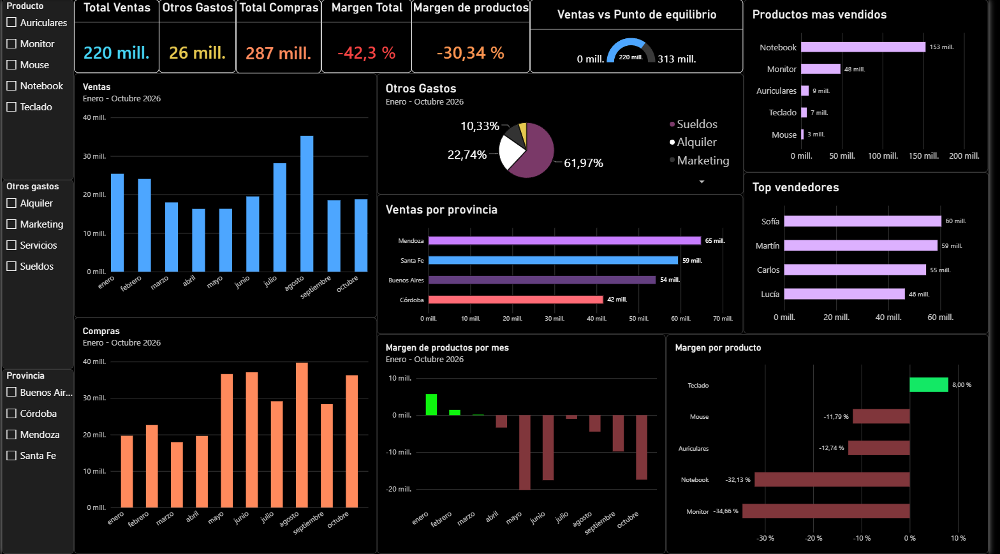

# Dashboard de Ventas - Power BI

Dashboard de ventas en Power BI (enero a octubre 2026): ventas, compras, márgenes por producto, gastos y análisis por provincia y vendedor.

> Los datos son ficticios y se usan solo con fines demostrativos.

## Vista previa

## Qué incluye

- KPIs principales: ventas, compras, otros gastos y margen total
- Ventas y compras por mes
- Productos más vendidos y top vendedores
- Ventas por provincia
- Distribución de otros gastos (sueldos, alquiler, marketing)
- Margen por producto y por mes
- Filtros por producto y provincia

## Archivos

- `Dashboard_ventas.pbix`: archivo del proyecto (se abre con Power BI Desktop)
